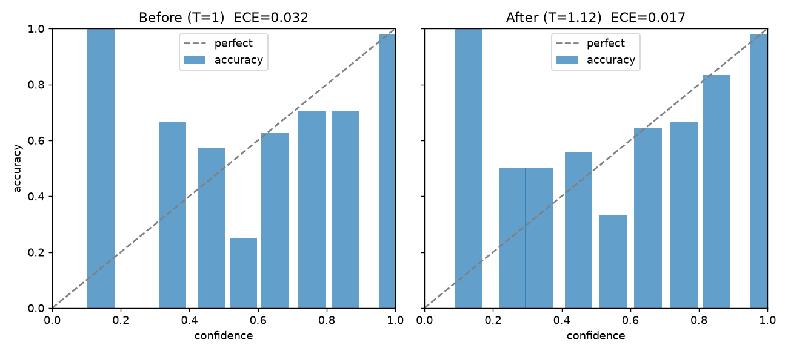
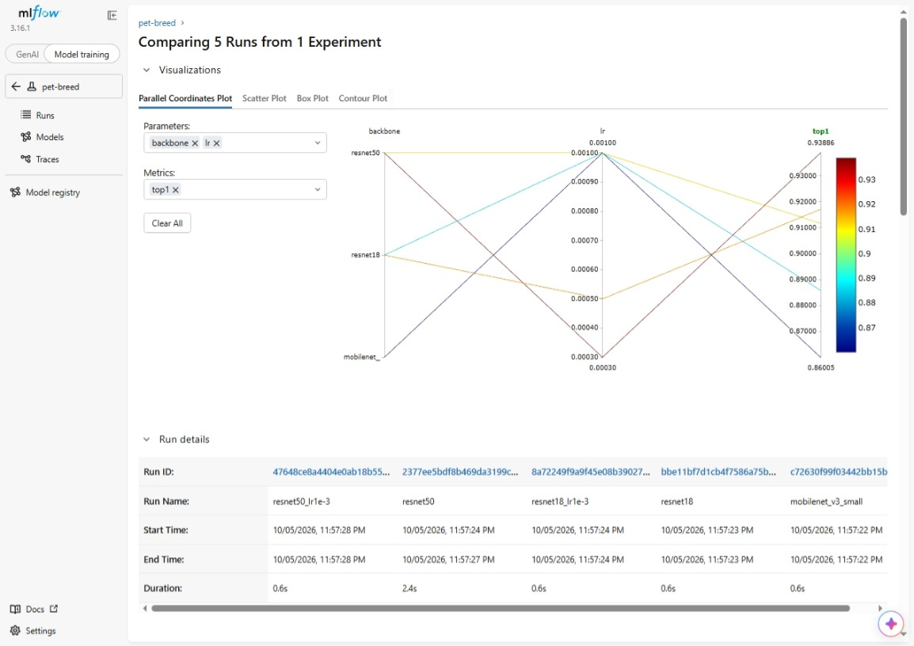
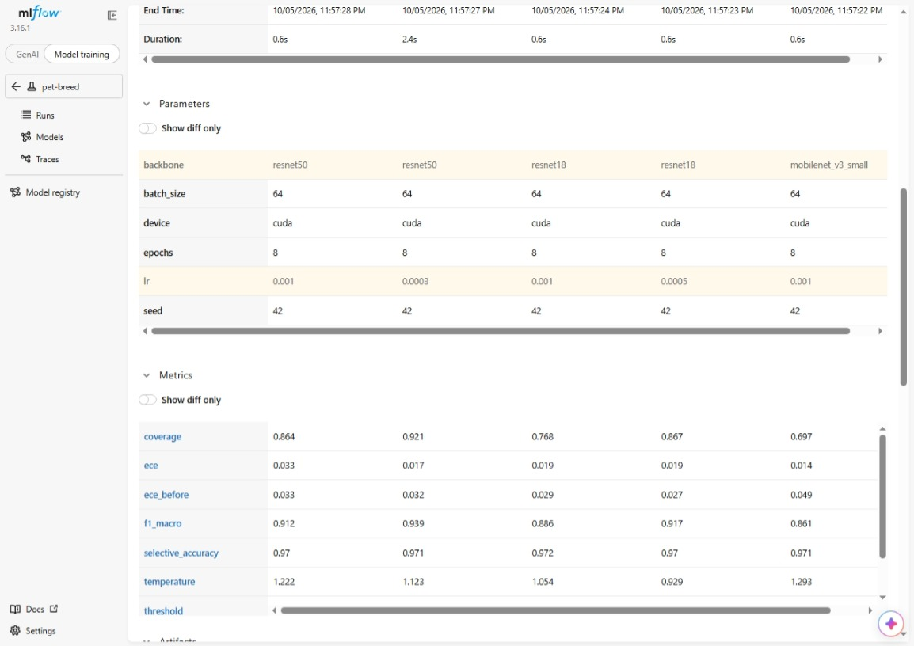

<div align="center">

<br/>

# Pet Breed Classification — MLOps Service

**An end-to-end computer-vision MLOps pipeline that identifies one of 37 cat and dog breeds from a photo — and answers "uncertain" instead of guessing when it is not sure.**

DVC-versioned data · PyTorch training · temperature-scaled calibration & abstention · MLflow registry · ONNX / OpenVINO / BentoML / TensorRT serving options · FastAPI backend · nginx canary · Prometheus + Grafana monitoring · Airflow drift-triggered retraining · Docker Compose · GitHub Actions CI

<br/>


<br/>

[Overview](#overview) · [Results](#results-at-a-glance) · [Architecture](#architecture) · [Pipeline Stages](#pipeline-stages) · [Project Structure](#project-structure) · [Quick Start](#quick-start) · [API Reference](#api-reference) · [Testing](#testing) · [Configuration](#configuration) · [Docker Compose](#docker-compose) · [CI/CD](#cicd) · [Tech Stack](#tech-stack)

<br/>

</div>

---

## Overview

This project is a **complete, containerized MLOps pipeline** for breed recognition on the Oxford-IIIT Pet dataset (37 classes: 12 cat breeds and 25 dog breeds).

It is built for a pet-care marketplace operating in Egypt, Saudi Arabia and the UAE, where a wrong breed on a listing is worse than no breed. The classifier is therefore **calibrated**: its confidence is temperature-scaled, and when confidence falls below a threshold the API returns `decision: "uncertain"` instead of a guess.

The repo takes the model lifecycle from a versioned image dataset to a monitored service: raw images are versioned with **DVC**, a **PyTorch** transfer-learning model (ResNet-50 in production) is trained and calibrated, runs are tracked and registered in **MLflow**, the model is exported to **ONNX** and benchmarked against PyTorch and OpenVINO, it is served by **FastAPI** (and optionally **BentoML**), the API exports **Prometheus** metrics including a prediction-drift score, and an **Airflow** DAG reacts to a drift alert by training a candidate model and running a quality gate against the baseline.

| Capability | Details |
|---|---|
| **Versioned data** | The Oxford-IIIT Pet archive is tracked with `DVC` (DagsHub remotes); manifest, splits and a corrupted test set are reproducible DVC stages |
| **Reproducible splits** | Official `trainval`/`test` lists + a seeded, stratified validation fold; the test split is never touched during training |
| **Transfer learning** | `resnet50`, `resnet18` or `mobilenet_v3_small` (ImageNet-pretrained) with a new 37-way head; best-validation checkpoint kept |
| **Calibrated abstention** | Temperature scaling on validation logits, plus the lowest threshold that reaches a 0.97 selective-accuracy target; both are stored inside `model.pt` |
| **Experiment tracking & registry** | `MLflow` logs params/metrics/artifacts per run and registers the best as `PetBreedClassifier` with alias `Production` |
| **Optimized inference** | ONNX export (logits match PyTorch to ~1e-5), benchmarked on ONNX Runtime and OpenVINO; TensorRT engine + Triton model repository included |
| **Typed API** | FastAPI accepts an uploaded image (`multipart/form-data`) and returns breed, species, confidence, top-3, decision and model version |
| **Canary routing** | nginx sends 95% of traffic to a `stable` model and 5% to a `canary` model |
| **Observability** | Prometheus metrics, a drift alert, and a provisioned Grafana dashboard |
| **Drift-triggered retraining** | An Airflow DAG trains an isolated candidate when the drift alert fires and runs a top-1 quality gate |
| **Automated tests & CI** | 71 pytest functions; GitHub Actions runs lint, tests, the quality gate and a Docker build |
| **Environment-driven config** | Paths, device, threshold and upload limit are set through `PET_*` variables / `.env` |

> **Who is this for?** Anyone learning how to take a classifier from a notebook-sized experiment to a calibrated, monitored, containerized service — including data versioning, abstention, a model registry, ONNX optimization, drift detection and an automated retraining loop.

---

## Results at a glance

All numbers are copied from files in [`reports/`](./reports). Accuracy is measured on the validation split (736 images).

| Item | Value | Source |
|---|---|---|
| Production model | ResNet-50, lr 0.0003, batch 64, 8 epochs, seed 42, trained on CUDA | [`reports/baseline.json`](./reports/baseline.json) |
| Top-1 / macro-F1 (val) | **0.9389** / **0.9392** | [`reports/baseline.json`](./reports/baseline.json) |
| Calibration | Temperature **1.12**; ECE **0.032 → 0.017** | [`reports/calibration_resnet50.png`](./reports/calibration_resnet50.png) |
| Abstention (target 0.97) | Coverage **0.921**, selective accuracy **0.971** | [`reports/mlflow_compare2.jpeg`](./reports/mlflow_compare2.jpeg) |
| ONNX vs PyTorch | Max logit difference 9.5e-06, top-1 agreement 1.0 on 200 images | [`reports/onnx_agreement.json`](./reports/onnx_agreement.json) |
| CPU latency p95 (batch 1) | PyTorch 97.4 ms → ONNX Runtime 48.1 ms → OpenVINO 42.1 ms | [`reports/benchmark_r1..r3.json`](./reports) |
| Load test p95 `/predict` | FastAPI 450 ms · BentoML 200 ms (10 users, 90 s, 0 failures) | [`reports/locust_*_stats.csv`](./reports) |
| Drift detection (corruption suite) | Pixel-statistics detector: 18/18 conditions detected; prediction-PSI detector: severity ≥ 2 only | [`reports/monitoring/`](./reports/monitoring) |



---

## Architecture

```
┌───────────────────────────────────────────────────────────────────────────────┐
│                  Pet Breed Classification — Architecture                      │
└───────────────────────────────────────────────────────────────────────────────┘

  ┌───────────────┐     ┌────────────────────────┐     ┌───────────────────────┐
  │  DATA LAYER   │     │   TRAINING (offline)   │     │  TRACKING & REGISTRY  │
  │               │     │                        │     │                       │
  │ data/archive  │     │ training/train.py      │     │  MLflow + Postgres    │
  │  (DVC remote) │────►│  → models/<run>/       │     │   experiment pet-breed│
  │ extract       │     │ training/calibrate.py  │────►│   model registered:   │
  │ manifest      │     │  → T + threshold       │     │   PetBreedClassifier  │
  │ corrupted     │     │ training/log_to_mlflow │     │   alias: Production   │
  └───────────────┘     └───────────┬────────────┘     └───────────────────────┘
                                    │
                                    ▼
                       ┌────────────────────────┐
                       │    MODEL ARTIFACTS     │
                       │ models/<run>/model.pt  │
                       │ eval_transform.json    │
                       │ model.onnx (export)    │
                       └───────────┬────────────┘
                                   │
        ┌──────────────────────────┼──────────────────────────────┐
        ▼                          ▼                              ▼
  ┌───────────────┐      ┌──────────────────┐          ┌──────────────────────┐
  │ FastAPI :8000 │      │ BentoML          │          │ TensorRT / Triton    │
  │ /predict      │      │ OnnxRunner +     │          │ model repository     │
  │ /health       │      │ PetBreed service │          │ (GPU only)           │
  │ /metrics      │      └──────────────────┘          └──────────────────────┘
  └───────┬───────┘
          │ scrape /metrics (15 s)                nginx :8081  95% stable (resnet18)
          ▼                                                    5%  canary (resnet50)
  ┌───────────────┐   alert PetBreedPredictionDrift   ┌─────────────────────────┐
  │ Prometheus    │──────────────────────────────────►│ Airflow :8082           │
  │ :9090         │                                   │ detect_drift → branch → │
  └───────┬───────┘                                   │ train_candidate →       │
          ▼                                           │ quality_gate →          │
  ┌───────────────┐                                   │ record_result           │
  │ Grafana :3000 │                                   └─────────────────────────┘
  └───────────────┘

     docker-compose.yml orchestrates the API, canary pair, nginx, MLflow, Postgres,
     Prometheus, Grafana and Airflow. GitHub Actions runs lint, tests, the top-1
     quality gate and a Docker image build.
```

---

## Pipeline Stages

### 1 — Data Versioning & Preparation

The Oxford-IIIT Pet archive (`data/archive`, 811 MB, `images.tar.gz` + `annotations.tar.gz`) is tracked with `DVC` (`data/archive.dvc`) against DagsHub remotes (`.dvc/config`). Three DVC stages in `dvc.yaml` turn it into training-ready data:

| Stage | Command | Outputs |
|---|---|---|
| `extract` | `uv run python data/extract_archive.py` | `data/raw/oxford-iiit-pet/{images,annotations}` |
| `manifest` | `uv run python data/build_manifest.py` | `data/manifest.json`, `data/splits/{train,val,test}.txt` |
| `corrupted` | `uv run python data/build_corrupted.py` | `data/corrupted/`, `data/manifest_corrupted.json`, `data/splits/drift_subset.txt` |

- **Splits:** the official `trainval` (3,680 images) and `test` (3,669 images) lists give 7,349 records. A stratified validation fold (20% per class, seed 42) is carved out of `trainval`, leaving 2,944 train and 736 validation images. The test split is never used by `training/train.py`.
- **Label map:** `configs/label_map.json` holds the 37 class names in alphabetical order. The manifest builder checks every filename against it and fails on any mismatch.
- **Manifest schema:** `image_id`, `path`, `breed`, `class_index` (0–36), `species` (`cat`/`dog`), `split`, `corruption` (`null` for clean images), `severity` (`0` for clean images), `width`, `height`.
- **Corruption suite:** 6 corruptions × 3 severities applied to a fixed seeded subset of 300 test images (5,400 files). It is the benchmark for the drift detectors in stage 8.

| Corruption | Severity 1 / 2 / 3 |
|---|---|
| `gaussian_blur` | radius 1.0 / 2.0 / 4.0 px |
| `brightness_up` | factor 1.3 / 1.6 / 2.0 |
| `brightness_down` | factor 0.7 / 0.5 / 0.3 |
| `jpeg` | quality 60 / 30 / 10 |
| `low_res` | downscale to 160 / 96 / 64 px, then back up |
| `motion_blur` | kernel length 5 / 11 / 21 px |

### 2 — Preprocessing & Augmentation

`src/pet_breed_mlops/preprocessing.py` defines the transforms. The evaluation transform is deterministic: resize 256 → center-crop 224 → ImageNet mean/std normalization. Training adds `RandomResizedCrop(224, scale=(0.6, 1.0))`, horizontal flip and light color jitter. `load_image()` decodes uploaded bytes into RGB (handling grayscale, CMYK, palette and RGBA) and raises a `ValueError` for non-images, which the API turns into a `422`. The eval-transform settings are saved next to the weights as `eval_transform.json`, so serving always rebuilds the exact training-time transform.

### 3 — Training

`training/train.py` fine-tunes an ImageNet-pretrained backbone (`resnet50`, `resnet18` or `mobilenet_v3_small`, see `src/pet_breed_mlops/backbones.py`) with a new 37-way head. Recipe: AdamW (weight decay 1e-4), cosine learning-rate schedule, batch 64, 8 epochs, seed 42, mixed precision when CUDA is available. The checkpoint with the best validation top-1 is kept. Each run directory `models/<run>/` contains `model.pt`, `eval_transform.json`, `val_logits.pt` and `metrics.json` (top-1 and macro-F1). The default backbone is `resnet18`, so always pass `--backbone` explicitly.

### 4 — Calibration & Abstention

`training/calibrate.py` reads the saved validation logits and:

1. fits a **temperature** `T` by minimising the negative log-likelihood of `softmax(logits / T)`;
2. reports **ECE** (15 bins) before and after scaling;
3. picks the **lowest confidence threshold** whose selective accuracy on validation reaches the target (default 0.97), which maximises **coverage** (the share of images the model answers);
4. with `--write-checkpoint`, stores `temperature` and `threshold` inside `model.pt`, so the API can never serve raw softmax.

At inference, `decision` is `"confident"` when calibrated confidence ≥ threshold and `"uncertain"` otherwise.

### 5 — Experiment Tracking & Model Registry

`training/log_to_mlflow.py` logs every run folder under `models/` to MLflow experiment `pet-breed` (skipping runs already logged):

- **Params:** `backbone`, `lr`, `batch_size`, `epochs`, `seed`, `device`
- **Metrics:** `top1`, `f1_macro`, `ece`, `ece_before`, `temperature`, `threshold`, `coverage`, `selective_accuracy`
- **Artifacts:** `metrics.json`, `calibration.json`, the calibration plot if present, and the weights (`model.pt`, `eval_transform.json`, `calibration.json`) for the best run only

The best run by top-1 is registered as **`PetBreedClassifier`** and receives the alias **`Production`**.

The five tracked runs (values from the MLflow comparison screenshots):

| Run | Backbone | lr | f1_macro | ECE before → after | Temperature | Coverage | Selective acc. |
|---|---|---|---|---|---|---|---|
| `resnet50` (production) | resnet50 | 0.0003 | 0.939 | 0.032 → 0.017 | 1.123 | 0.921 | 0.971 |
| `resnet50_lr1e-3` | resnet50 | 0.001 | 0.912 | 0.033 → 0.033 | 1.222 | 0.864 | 0.970 |
| `resnet18` | resnet18 | 0.0005 | 0.917 | 0.027 → 0.019 | 0.929 | 0.867 | 0.970 |
| `resnet18_lr1e-3` | resnet18 | 0.001 | 0.886 | 0.029 → 0.019 | 1.054 | 0.768 | 0.972 |
| `mobilenet_v3_small` | mobilenet_v3_small | 0.001 | 0.861 | 0.049 → 0.014 | 1.293 | 0.697 | 0.971 |




### 6 — Export & Optimization

`src/pet_breed_mlops/onnx_export.py` exports the checkpoint to **ONNX** (opset 17, input `image`, output `logits`, dynamic batch) and verifies it against PyTorch on 200 validation images, writing `reports/onnx_agreement.json` and failing if the max logit difference exceeds the tolerance.

`optimization/benchmark.py` then times PyTorch, ONNX Runtime and **OpenVINO** at batch 1 on the same machine. Hardware is tagged and recorded in [`reports/hardware.md`](./reports/hardware.md) — numbers from different hardware are never mixed in one table. `optimization/summarize.py` aggregates several rounds.

Measured on `laptop-cpu` (Intel Core i7-7820HQ, 8 logical cores, no GPU), validation top-1 on 736 images, p95 as the median of 3 rounds (range in brackets):

| Backend | top-1 | p95 | size |
|---|---|---|---|
| PyTorch FP32 (baseline) | 0.9389 | 97.4 ms (91.0–114.0) | 94.6 MB |
| ONNX Runtime FP32 | 0.9389 | 48.1 ms (44.5–52.1) | 94.3 MB |
| OpenVINO FP32 | 0.9389 | 42.1 ms (39.6–63.3) | 94.3 MB |

All three return identical top-1. OpenVINO was slower than ONNX Runtime in one of three rounds, but faster than PyTorch in every round.

A **TensorRT FP16** engine for GPU serving is tracked with DVC at `artifacts/triton-tensorrt/triton-model-repository/pet_breed/1/model.plan.dvc` (47,460,652 bytes), together with its Triton `config.pbtxt` (platform `tensorrt_plan`, FP16 input `[3,224,224]`, 37 logits, `max_batch_size 16`, dynamic batching with preferred sizes 8 and 16, one GPU instance). It needs an NVIDIA GPU and a Triton server version compatible with the TensorRT version that built the plan; it is not part of `docker-compose.yml`.

### 7 — Model Serving

**FastAPI** (`src/pet_breed_mlops/main.py`) loads `PetBreedClassifier` once at startup and exposes `/predict`, `/health` and `/metrics`. Uploads are limited to 5 MB by default; empty files, non-images and a missing `file` field return `422`.

**BentoML** (`src/pet_breed_mlops/bento_service.py`) is an alternative server that runs the ONNX model: `OnnxRunner` (ONNX Runtime CPU, request batching with `max_batch_size=32` and `max_latency_ms=30`) behind a `PetBreed` service. Its `/predict` takes the multipart field **`image`** and its `/health` is a `POST`.

**nginx canary** (`docker/nginx/default.conf`): `split_clients` routes 95% of requests to `stable` (ResNet-18) and 5% to `canary` (ResNet-50) on port `8081`. Every response carries an `X-Pet-Backend` header showing which backend answered.

**Batch scoring** (`scripts/batch_score.py`) scores a folder of images offline and writes `predictions.csv` and `summary.json` to `reports/batch_scoring/`. The committed run scored 1,000 images (900 `confident`, 100 `uncertain`, 11.2 images/s); it is an operational report, not an accuracy evaluation.

### 8 — Monitoring & Drift Detection

The API keeps a sliding window of the last **100 predicted breeds** and computes the **Population Stability Index (PSI)** against the validation prediction distribution (`reports/monitoring/baseline.json`). It exports:

| Metric | Type | Meaning |
|---|---|---|
| `pet_breed_prediction_requests_total{status}` | counter | `/predict` calls, `success` or `failure` |
| `pet_breed_prediction_duration_seconds` | histogram | request latency |
| `pet_breed_prediction_confidence` | histogram | confidence of successful predictions |
| `pet_breed_drift_score` | gauge | latest PSI |
| `pet_breed_drift_window_ready` | gauge | `1` once the 100-image window is full |

Prometheus (`monitoring/prometheus/`) scrapes `api:8000/metrics` every 15 s. The alert **`PetBreedPredictionDrift`** fires when `pet_breed_drift_window_ready == 1` and `pet_breed_drift_score > 1.602368` for 30 s. That threshold is the 95th percentile of PSI over 1,000 simulated clean batches of 100 images. Grafana (`monitoring/grafana/`) provisions a Prometheus datasource and the dashboard *Pet Breed Monitoring* with four panels: Drift Window Ready, Data Drift Score, Average Prediction Confidence, Average Prediction Latency.

Two detectors are evaluated offline against the corruption suite (18 conditions; PSI uses 7 batches of 100 per condition, pixel statistics use 3 batches of 50). In both cases the false-alarm rate on clean batches was 0.0, estimated from few batches:

| Detector | Signal | Result |
|---|---|---|
| **Prediction PSI** (runs in the API) | distribution of predicted breeds | detects severity 3 of blur / JPEG / low-res / motion-blur and low-res severity 2; never fires on brightness changes or severity 1 |
| **Pixel statistics** (offline scripts) | mean/std RGB, brightness, edge strength, JPEG blockiness; threshold 0.3916 | detects all 18 conditions |

Per-condition scores are in [`reports/monitoring/drift_scorecard.csv`](./reports/monitoring/drift_scorecard.csv) and [`pixel_drift_scorecard.csv`](./reports/monitoring/pixel_drift_scorecard.csv). `scripts/build_evidently_report.py` additionally builds an **Evidently** data-drift report comparing validation predictions against `gaussian_blur` severity 2.

### 9 — Automated Retraining (Airflow)

The DAG **`pet_breed_drift_retraining`** (`airflow/dags/pet_breed_drift_retraining.py`) runs every 5 minutes (`*/5 * * * *`, one active run at a time):

1. **`detect_drift`** — reads Prometheus `/api/v1/alerts` and looks for a firing `PetBreedPredictionDrift`. Each alert *episode* (identified by `activeAt`) is handled once: episodes that already passed or failed the gate are skipped via Airflow Variables.
2. **`route_drift`** — branches to `train_candidate` or `no_drift`.
3. **`train_candidate`** — a `DockerOperator` runs `training/train.py` in the `pet-breed-training:local` image (ResNet-50, lr 0.0003, batch 64, 8 epochs, seed 42) into `models/candidates/<timestamp>/`.
4. **`quality_gate`** — runs `pet_breed_mlops.quality_gate_runner`, comparing the candidate's `metrics.json` with `reports/baseline.json` at tolerance 0.01, and writes `quality_gate_result.json`.
5. **`record_result`** — stores the episode in Variables; fails the run if the gate rejected the candidate.
6. **`finish`**.

The gate passes if `candidate top-1 ≥ baseline top-1 − 0.01`. A passing candidate is **not promoted automatically**: it stays in `models/candidates/` and the production model is left unchanged, so a human decides what ships.

### 10 — Testing & CI

71 pytest functions cover data, preprocessing, calibration, inference, the HTTP API, monitoring, ONNX agreement, the BentoML service and the quality gate — see [Testing](#testing). GitHub Actions runs them on every pull request and push — see [CI/CD](#cicd).

---

## Project Structure

```
Pet-Breed-Classification-MLOps-Final-Project/
├── .github/workflows/
│   └── ci.yml                         # lint → test + quality-gate → docker build/push
├── airflow/
│   ├── Dockerfile                     # Airflow 2.10.5 + Docker provider on the training image
│   └── dags/
│       └── pet_breed_drift_retraining.py   # drift → candidate training → quality gate
├── artifacts/triton-tensorrt/
│   └── triton-model-repository/pet_breed/
│       ├── config.pbtxt               # Triton config (TensorRT plan, FP16, dynamic batching)
│       └── 1/model.plan.dvc           # DVC pointer to the TensorRT engine
├── configs/
│   └── label_map.json                 # 37 class names, alphabetical
├── data/
│   ├── archive.dvc                    # DVC pointer to the dataset archive
│   ├── extract_archive.py             # DVC stage: extract
│   ├── build_manifest.py              # DVC stage: manifest + train/val/test splits
│   ├── build_corrupted.py             # DVC stage: corrupted test subset
│   └── make_label_map.py              # builds configs/label_map.json via torchvision
├── docker/
│   ├── mlflow/Dockerfile              # MLflow 3.16.1 server image
│   ├── nginx/default.conf             # 95/5 stable/canary split
│   └── training/Dockerfile            # training image used by Airflow
├── load_tests/
│   ├── locustfile.py                  # Locust scenario for FastAPI
│   └── locustfile_bento.py            # Locust scenario for BentoML
├── monitoring/
│   ├── prometheus/                    # prometheus.yml, alert_rules.yml
│   └── grafana/                       # dashboard JSON + provisioning
├── optimization/
│   ├── benchmark.py                   # PyTorch vs ONNX Runtime vs OpenVINO latency
│   ├── summarize.py                   # aggregates benchmark rounds
│   └── ov_probe.py                    # OpenVINO configuration probe
├── reports/                           # metrics, plots, benchmarks, Locust, drift scorecards
├── scripts/
│   ├── batch_score.py                 # offline batch scoring
│   ├── build_monitoring_baseline.py   # prediction baseline used by the API drift score
│   ├── build_drift_scorecard.py       # PSI detector vs corruption suite
│   ├── build_pixel_baseline.py        # pixel-statistics baseline
│   ├── build_pixel_drift_scorecard.py # pixel detector vs corruption suite
│   ├── build_evidently_report.py      # Evidently data-drift report
│   ├── show_pixel_drift_results.py    # prints the pixel scorecard
│   ├── hardware_report.py             # writes reports/hardware.md
│   └── register_bento_model.py        # registers the ONNX model with BentoML
├── src/pet_breed_mlops/
│   ├── main.py                        # FastAPI app: /health, /predict, /metrics
│   ├── inference.py                   # PetBreedClassifier (weights + temperature + threshold)
│   ├── preprocessing.py               # eval/train transforms, image decoding
│   ├── backbones.py                   # resnet50 / resnet18 / mobilenet_v3_small
│   ├── calibration.py                 # temperature scaling, ECE, reliability, abstention
│   ├── monitoring.py                  # PSI
│   ├── pixel_monitoring.py            # pixel-statistics drift
│   ├── corruptions.py                 # the 6-corruption suite
│   ├── onnx_export.py                 # ONNX export + agreement check
│   ├── bento_service.py               # BentoML services
│   ├── quality_gate.py / quality_gate_runner.py   # top-1 gate (CLI + Airflow wrapper)
│   ├── config.py · labels.py · schemas.py
│   └── __init__.py
├── tests/                             # 13 test modules + conftest.py (71 test functions)
├── training/
│   ├── train.py                       # fine-tuning, best-checkpoint selection
│   ├── calibrate.py                   # temperature + threshold, writes into model.pt
│   ├── log_to_mlflow.py               # logs runs, registers + promotes the best
│   └── init_checkpoint.py             # untrained placeholder checkpoint (smoke tests)
├── docker-compose.yml                 # API, canary, nginx, MLflow, Postgres, Prometheus, Grafana, Airflow
├── Dockerfile                         # API image (python:3.12-slim + uv)
├── dvc.yaml / dvc.lock                # data pipeline
├── .dvc/config                        # DVC remotes (DagsHub)
├── pyproject.toml / uv.lock           # uv-managed dependencies and groups
└── .env.example                       # environment variable template
```

---

## Quick Start

### Prerequisites

```
Python 3.12   git   uv   docker + docker compose (for the full stack)
```

Optional: an NVIDIA GPU with a CUDA build of PyTorch for faster training (`uv sync` installs the CPU build), and access to the DagsHub DVC remote (otherwise use the download fallback in step 3).

### Fastest check — API in 3 commands (no dataset, no GPU)

This starts the API on port 8000 with an **untrained placeholder checkpoint** (`v0-untrained`): everything works, predictions are meaningless. Use it to verify your setup, then follow the full path below for real weights.

```bash
git clone https://github.com/mohamed1-abdeldayem/Pet-Breed-Classification-MLOps-Final-Project.git && cd Pet-Breed-Classification-MLOps-Final-Project
uv sync --frozen && uv run python training/init_checkpoint.py
uv run uvicorn pet_breed_mlops.main:app --host 0.0.0.0 --port 8000
```

```bash
curl http://localhost:8000/health
# {"status":"healthy","model_version":"v0-untrained","num_classes":37}
```

### Full path — from raw data to a trained, calibrated, served model

#### 1. Clone & install

```bash
git clone https://github.com/mohamed1-abdeldayem/Pet-Breed-Classification-MLOps-Final-Project.git
cd Pet-Breed-Classification-MLOps-Final-Project
uv sync --frozen
cp .env.example .env
```

#### 2. Configure environment

`.env` is read by the API (see [Configuration](#configuration)). The defaults are fine for step 1; later you will point `PET_MODEL_DIR` at a trained run.

#### 3. Get the dataset

**Option A — DVC** (needs access to the DagsHub remote in `.dvc/config`):

```bash
uv run dvc pull
uv run dvc repro        # extract → manifest → corrupted
```

**Option B — without DVC access:** download the dataset with torchvision (the same dataset the DVC archive holds), then build the manifest and the corrupted set directly:

```bash
uv run python -c "from torchvision.datasets import OxfordIIITPet; OxfordIIITPet(root='data/raw', split='trainval', download=True)"
uv run python data/build_manifest.py
uv run python data/build_corrupted.py
```

Use one option or the other, not both. Afterwards you should have `data/manifest.json`, `data/splits/{train,val,test}.txt` and `data/corrupted/`.

#### 4. Train

The production model and the four comparison runs (hyperparameters from the MLflow screenshots in `reports/`):

```bash
# production model (also what the monitoring scripts and the API containers expect at models/resnet50)
uv run python training/train.py --backbone resnet50 --lr 0.0003

# smaller model used as the nginx "stable" backend
uv run python training/train.py --backbone resnet18 --lr 0.0005

# optional comparison runs
uv run python training/train.py --backbone resnet50 --lr 0.001 --out-dir models/resnet50_lr1e-3
uv run python training/train.py --backbone resnet18 --lr 0.001 --out-dir models/resnet18_lr1e-3
uv run python training/train.py --backbone mobilenet_v3_small --lr 0.001
```

Defaults: batch 64, 8 epochs, seed 42, model version `v1`, output to `models/<backbone>`. CUDA is used automatically when PyTorch can see a GPU; ImageNet weights are downloaded on first use, so this step needs internet access. A single-backbone run is enough to continue.

#### 5. Calibrate

```bash
uv run python training/calibrate.py models/resnet50 --write-checkpoint
uv run python training/calibrate.py models/resnet18 --write-checkpoint
```

This writes `models/<run>/calibration.json` (temperature, ECE before/after, threshold, coverage, selective accuracy) and stores the temperature and threshold inside `model.pt`. Use `--target-accuracy` to change the 0.97 selective-accuracy target.

#### 6. Run the API

Set the model directory in `.env`:

```
PET_MODEL_DIR=models/resnet50
```

```bash
uv run uvicorn pet_breed_mlops.main:app --host 0.0.0.0 --port 8000
```

Interactive docs are at <http://localhost:8000/docs>.

```bash
curl -X POST http://localhost:8000/predict -F "file=@/path/to/pet.jpg"
```

#### 7. Track experiments in MLflow (optional)

```bash
docker compose up -d postgres mlflow          # MLflow UI on http://localhost:5000
uv run python training/log_to_mlflow.py --models-dir models
```

Each run folder under `models/` (with its `metrics.json` and `calibration.json`) is logged; the best by top-1 is registered as `PetBreedClassifier` with alias `Production`. Use `--tracking-uri` or `MLFLOW_TRACKING_URI` to log to a different server.

#### 8. Export to ONNX and benchmark (optional)

```bash
uv run --group onnx python -m pet_breed_mlops.onnx_export models/resnet50
uv run python scripts/hardware_report.py --label laptop-cpu
uv run --group onnx python optimization/benchmark.py models/resnet50 --runs 1000
```

The export writes `models/resnet50/model.onnx` and `reports/onnx_agreement.json` and exits non-zero if ONNX and PyTorch disagree. The benchmark writes `reports/benchmark_results.json`; use `--out reports/benchmark_r1.json` (r2, r3…) and `uv run python optimization/summarize.py` to aggregate several rounds. Use a `--label` that matches the machine described in `reports/hardware.md`.

#### 9. Serve with BentoML (optional)

```bash
uv run --group serve --group onnx python scripts/register_bento_model.py
uv run --group serve --group onnx bentoml serve pet_breed_mlops.bento_service:PetBreed --port 3001
```

Port 3001 avoids a clash with Grafana on 3000. The `/predict` endpoint takes the multipart field `image`:

```bash
curl -X POST http://localhost:3001/predict -F "image=@/path/to/pet.jpg"
```

#### 10. Load test (optional)

```bash
# FastAPI on :8000
uv run --group load locust -f load_tests/locustfile.py --host http://localhost:8000 --headless -u 10 -r 2 -t 90s
# BentoML on :3001
uv run --group load locust -f load_tests/locustfile_bento.py --host http://localhost:3001 --headless -u 10 -r 2 -t 90s
```

The Locust files read the dataset images from `data/raw/oxford-iiit-pet/images`, so complete step 3 first. The committed reports used these settings.

#### 11. Rebuild the monitoring artifacts (optional)

These scripts expect the production model at `models/resnet50` and the data from step 3:

```bash
uv run python scripts/build_monitoring_baseline.py        # → reports/monitoring/baseline.json (read by the API)
uv run python scripts/build_drift_scorecard.py            # PSI detector vs corruption suite
uv run python scripts/build_pixel_baseline.py
uv run python scripts/build_pixel_drift_scorecard.py      # pixel detector vs corruption suite
uv run python scripts/show_pixel_drift_results.py
uv run python scripts/build_evidently_report.py           # → reports/monitoring/evidently_gaussian_blur_s2.html
uv run python scripts/batch_score.py --limit 1000         # → reports/batch_scoring/
```

The committed baseline and scorecards were produced for the committed ResNet-50 model, so the API's drift score only makes sense with the baseline that matches the model it serves.

#### 12. Run the tests and linter

```bash
uv run ruff check .
uv run --group serve pytest -q
```

See [Testing](#testing) for what is skipped without data or the `onnx` group.

#### 13. Full Docker stack

See [Docker Compose](#docker-compose).

---

## API Reference

Interactive docs auto-generated by FastAPI at <http://localhost:8000/docs>.

---

### `POST /predict` — Classify a pet photo

**Request:** `multipart/form-data` with a single field:

| Field | Type | Description |
|---|---|---|
| `file` | image file (JPEG, PNG, …) | Photo of a cat or dog, up to `PET_MAX_UPLOAD_BYTES` (5 MB default) |

```bash
curl -X POST http://localhost:8000/predict -F "file=@pet.jpg"
```

**Response** (illustrative values; the field layout and the first four values are real — they come from a scored image in `reports/batch_scoring/predictions.csv`):

```json
{
  "breed": "Abyssinian",
  "species": "cat",
  "confidence": 0.9979,
  "top_3": [
    {"breed": "Abyssinian", "probability": 0.9979},
    {"breed": "Bengal", "probability": 0.0011},
    {"breed": "Egyptian Mau", "probability": 0.0004}
  ],
  "decision": "confident",
  "model_version": "v1"
}
```

- `confidence` is the temperature-scaled softmax probability of the top breed (it equals `top_3[0].probability`).
- `decision` is `"confident"` if `confidence` ≥ the calibrated threshold, otherwise `"uncertain"` — in that case, do not trust the breed.
- **Errors:** `422` for an empty file, a file that is not an image, an upload over the size limit, or a missing `file` field.

---

### `GET /health` — Health check

```bash
curl http://localhost:8000/health
# {"status":"healthy","model_version":"v1","num_classes":37}
```

---

### `GET /metrics` — Prometheus metrics

Standard Prometheus text format; the application metrics are listed in [stage 8](#8--monitoring--drift-detection).

---

### BentoML service (optional, port 3000 by default)

| Endpoint | Method | Input | Output |
|---|---|---|---|
| `/predict` | `POST` | multipart field `image` | same JSON fields as FastAPI |
| `/health` | `POST` | `{}` | `{"status","model_version","num_classes"}` |

---

## Testing

71 test functions in 13 modules (`tests/`, plus `conftest.py`, which builds an untrained ResNet-18 checkpoint so no trained model is needed):

```
tests/
├── test_api.py              — /health, /predict schema, odd image modes, 422 cases (empty, non-image,
│                              oversized, missing field), Prometheus counters and drift gauges
├── test_inference.py        — prediction structure, sorted top-3, determinism, abstention below the
│                              threshold, label-map size check
├── test_calibration.py      — temperature lowers ECE and never changes predictions; higher threshold
│                              lowers coverage
├── test_preprocessing.py    — output shape/dtype, determinism, channel modes, config round trip
├── test_corruptions.py      — size and RGB preserved, monotonic severity, determinism, brightness direction
├── test_data_manifest.py    — files open, no split overlap, split sizes, labels and species match the
│                              map, ≥ 50 train images per class, every class in val and test,
│                              no image under 32×32
├── test_labels.py           — 37 unique classes
├── test_monitoring.py       — PSI behaviour and input validation
├── test_pixel_monitoring.py — pixel statistics and comparison behaviour
├── test_agreement.py        — classifier, HTTP response and training path give the same logits;
│                              transform matches a hand-written ImageNet normalization
├── test_onnx_agreement.py   — ONNX logits match PyTorch; dynamic batch size
├── test_bento_service.py    — health contract, response schema, valid probabilities, temperature applied
└── test_quality_gate.py     — equal/within-tolerance passes, larger drop fails, CLI exit codes
```

```bash
uv run --group serve pytest -q
```

- `test_data_manifest.py` is **skipped** until `data/manifest.json` exists (run step 3 first).
- `test_onnx_agreement.py` is **skipped** unless the `onnx` group is installed: `uv run --group serve --group onnx pytest -q`.
- Everything else runs on a fresh clone with no dataset and no trained weights.

---

## Configuration

The API reads its settings from environment variables with the `PET_` prefix (via `pydantic-settings`, also loaded from a `.env` file in the working directory):

```bash
# .env
PET_MODEL_DIR=models/resnet50
PET_MAX_UPLOAD_BYTES=5242880
PET_DEVICE=cpu
```

| Variable | Default | Used by | Purpose |
|---|---|---|---|
| `PET_MODEL_DIR` | `models` | API | Directory with `model.pt` and `eval_transform.json` (the Docker image sets `/app/models`; compose overrides it per service) |
| `PET_MONITORING_BASELINE_PATH` | `reports/monitoring/baseline.json` | API | Prediction baseline for the drift score |
| `PET_MAX_UPLOAD_BYTES` | `5242880` | API | Upload size limit (5 MB) |
| `PET_THRESHOLD` | unset | API | Overrides the calibrated threshold stored in `model.pt` (falls back to 0.5 if the checkpoint has none) |
| `PET_DEVICE` | `cpu` | API | PyTorch device for inference |
| `PET_LABEL_MAP` | `configs/label_map.json` | API, training | Path to the label map (the Docker image sets `/app/configs/label_map.json`) |
| `MLFLOW_TRACKING_URI` | `http://localhost:5000` | `training/log_to_mlflow.py` | MLflow server to log to |
| `PROJECT_ROOT` | — (required) | Docker Compose, Airflow DAG | **Absolute host path** of this repo; the DAG bind-mounts it into training containers |

DVC remotes are configured in `.dvc/config` (DagsHub). Prometheus, Grafana, nginx and MLflow settings live in `monitoring/`, `docker/nginx/default.conf` and `docker-compose.yml`.

---

## Docker Compose

### Images

| Image | Built from | What it is |
|---|---|---|
| `pet-breed` | `Dockerfile` | API image: `python:3.12-slim` + `uv`, locked dependencies without dev groups, non-root user, `/health` healthcheck, serves `pet_breed_mlops.main:app` on 8000 |
| `pet-breed-training:local` | `docker/training/Dockerfile` | `FROM pet-breed` plus `training/` and `configs/`; used by Airflow to train candidates |
| `pet-breed-airflow:local` | `airflow/Dockerfile` | `FROM pet-breed-training:local` plus Airflow 2.10.5 and the Docker provider in a separate venv |
| MLflow | `docker/mlflow/Dockerfile` | MLflow 3.16.1 server with the Postgres driver |

### Services

| Service | URL / port | Role |
|---|---|---|
| `api` | <http://localhost:8000> | FastAPI with `models/resnet50`; scraped by Prometheus |
| `stable` / `canary` | internal | FastAPI with `models/resnet18` / `models/resnet50`, behind nginx |
| `nginx` | <http://localhost:8081> | 95% → `stable`, 5% → `canary`; adds the `X-Pet-Backend` header |
| `postgres` | internal | MLflow backend store (`postgres:16`, demo credentials) |
| `mlflow` | <http://localhost:5000> | Tracking server and registry, artifacts served from the `mlartifacts` volume |
| `prometheus` | <http://localhost:9090> | Scrapes `api:8000/metrics`, evaluates the drift alert |
| `grafana` | <http://localhost:3000> | Dashboards (Prometheus datasource pre-provisioned) |
| `training-runner` | — | Idle container on the training image with the repo mounted at `/workspace` |
| `airflow` | <http://localhost:8082> | Runs the retraining DAG (`SequentialExecutor`, SQLite) and launches training containers through the Docker socket |

### Bring the stack up

The containers mount `./models`, so **train and calibrate `resnet50` and `resnet18` first** (steps 4–5 above). Then:

```bash
# 1. build the images (the training and Airflow images build on top of pet-breed)
docker build -t pet-breed .
docker build -f docker/training/Dockerfile -t pet-breed-training:local .
docker build -t pet-breed-airflow:local ./airflow

# 2. tell Compose where the repo lives on the host (absolute path)
export PROJECT_ROOT="$(pwd)"            # PowerShell: $env:PROJECT_ROOT = (Get-Location).Path

# 3. start everything
docker compose up -d
```

Check it:

```bash
curl http://localhost:8000/health
curl -i -X POST http://localhost:8081/predict -F "file=@/path/to/pet.jpg"   # note the X-Pet-Backend header
```

- **Grafana:** open <http://localhost:3000> (default Grafana credentials, `admin` / `admin`, unless you changed them) → dashboard *Pet Breed Monitoring*.
- **Prometheus alerts:** <http://localhost:9090/alerts>.
- **Airflow login:** the standalone server prints an `admin` password at startup: `docker logs pet-breed-airflow 2>&1 | grep -i password`. If the `pet_breed_drift_retraining` DAG is missing from the UI, `PROJECT_ROOT` was not set when the container started.

### Demo: trigger the drift alert and the retraining DAG

The API's drift score only updates once 100 predictions have been seen. Feeding it 100 heavily corrupted images pushes the predicted-breed distribution away from the baseline:

```bash
for f in $(ls data/corrupted/low_res/s3/*.jpg | head -100); do
  curl -s -o /dev/null -X POST http://localhost:8000/predict -F "file=@$f"
done
```

Within a minute `PetBreedPredictionDrift` should show as *firing* on the Prometheus alerts page, and the DAG picks it up on its next 5-minute run. `train_candidate` then trains a full ResNet-50 for 8 epochs inside a container — on CPU this takes a long time. When it finishes, check `models/candidates/<timestamp>/quality_gate_result.json`.

Stop everything with `docker compose down` (add `-v` to also delete the MLflow, Postgres and Grafana volumes).

---

## CI/CD

One GitHub Actions workflow, `.github/workflows/ci.yml`, runs on pull requests and on pushes to `main`:

| Job | Runs after | What it does |
|---|---|---|
| **`lint`** | — | `uv sync --frozen` then `uv run ruff check .` |
| **`test`** | `lint` | `uv sync --frozen --group serve` then `uv run pytest -q` |
| **`quality-gate`** | `lint` | `uv run python -m pet_breed_mlops.quality_gate` — fails if the candidate top-1 in `reports/latest_metrics.json` is more than 0.01 below `reports/baseline.json` |
| **`docker`** | `test`, `quality-gate` | Builds the API image with Buildx and GitHub Actions cache; on pushes to `main` it also pushes `ghcr.io/<owner>/<repo>` tagged with the commit SHA and `latest` |

To use the gate for a new model, regenerate `reports/latest_metrics.json` from the new run's `metrics.json` and commit it; only update `reports/baseline.json` when you deliberately change the reference.

---

## Design Decisions

- **Committed label map.** Class order lives in `configs/label_map.json`, and the manifest builder fails if a filename disagrees with it, so a silent label shift is impossible.
- **Test split is sealed.** Training and calibration use only the train and validation splits.
- **Weights, calibration and transform travel together.** `model.pt` stores the temperature and threshold, and `eval_transform.json` sits next to it, so the API, BentoML service and ONNX export can never disagree with training.
- **Hardware-tagged benchmarks.** Every latency number carries a hardware label tied to `reports/hardware.md`; numbers from different machines are never combined.
- **No automatic promotion.** The retraining loop produces and judges a candidate but leaves the decision to ship to a person.
- **One retrain per alert episode.** The DAG remembers which drift episodes it has already handled, so a long-running alert cannot trigger endless retraining.

## Notes & Limitations

- Accuracy, calibration and monitoring baselines are measured on the **validation** split; no test-set metric is reported. The training data is Oxford-IIIT Pet, not images from the target markets.
- Trained weights are not stored in Git (`*.pt` is gitignored); generate them with steps 4–5.
- The drift alert in production uses the prediction-PSI detector. The pixel-statistics detector is more sensitive but currently runs only as an offline script. Clean false-alarm rates were estimated from few batches and are not a production guarantee.
- Latency and load-test numbers come from a single laptop CPU and vary between rounds (e.g. PyTorch p95 91.0–114.0 ms).
- The Airflow setup (SQLite, `SequentialExecutor`, Docker socket mount) and the demo Postgres credentials are intended for local development, not production.
- Prometheus scrapes the `api` service only, not the `stable`/`canary` pair behind nginx.

---

## Tech Stack

| Layer | Technology | Role |
|---|---|---|
| Dataset | Oxford-IIIT Pet (37 breeds) | Fine-grained cat/dog breed classification |
| Data versioning | `DVC` + DagsHub remotes | Version the dataset and reproduce splits and the corrupted test set |
| ML | PyTorch / torchvision — ResNet-50, ResNet-18, MobileNetV3-Small | Transfer-learning classifier |
| Calibration | Temperature scaling, ECE, selective accuracy | Trustworthy confidence and abstention |
| Experiment tracking & registry | `MLflow` + PostgreSQL | Params, metrics, artifacts, model registry with `Production` alias |
| Model export | ONNX (`torch.onnx`), `onnxruntime`, OpenVINO | CPU-optimized inference and benchmarking |
| GPU serving artifacts | TensorRT plan + Triton model repository | GPU inference configuration (DVC-tracked engine) |
| API | FastAPI + `pydantic-settings` + `prometheus-client` | Multipart upload endpoint, env-driven config, metrics |
| Alternative server | `BentoML` | Batched ONNX Runtime serving |
| Traffic management | nginx | 95/5 stable/canary split |
| Monitoring | Prometheus, Grafana, Evidently | Metrics, drift alert, dashboards, drift reports |
| Orchestration | Apache Airflow 2.10 + Docker provider | Drift-triggered candidate training and quality gate |
| Load testing | Locust | `/predict` latency under concurrent users |
| Testing | Pytest + FastAPI `TestClient` | 71 test functions |
| Code quality | `ruff` | Linting in CI |
| CI | GitHub Actions + GitHub Container Registry | Lint, test, quality gate, image build/push |
| Packaging & containers | `uv`, Docker, Docker Compose | Locked dependencies and reproducible local orchestration |

---

## Contributing

Pull requests are welcome. For larger changes, please open an issue first to discuss what you would like to change.

```bash
git checkout -b feature/your-feature
# make changes
uv run ruff check .
uv run --group serve pytest -q
git commit -m "feat: add your feature"
git push origin feature/your-feature
# open a pull request
```

---

<div align="center">

Built by [mohamed1-abdeldayem](https://github.com/mohamed1-abdeldayem) · [Repository](https://github.com/mohamed1-abdeldayem/Pet-Breed-Classification-MLOps-Final-Project)

</div>